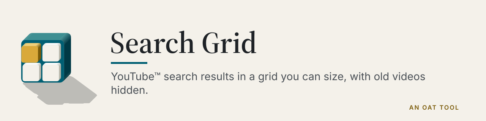

<picture>
  <source media="(prefers-color-scheme: dark)" srcset="brand/banner/search-grid-readme-hero-1280x320-dark.png">
  
</picture>

# Search Grid & Recency Filter for YouTube™

A free Chrome extension that does two things on YouTube:

- **Grid view for search results.** Shows search results as a grid of
  cards instead of one long list. You choose how wide each card is, so you
  choose how many columns you get.
- **Recency filter.** Hides videos older than a number of days you pick,
  on search results and on the home page. Off by default.

Both settings live in the toolbar popup and apply as soon as you press
**Save**.

**[Install from the Chrome Web Store](https://chromewebstore.google.com/detail/search-grid-recency-filte/ljghjhddjnnnjmaakpimcbidjckddgdf)**

- Support and questions: <https://owensappliedthinking.com/tools/search-grid/>
- Privacy policy: <https://owensappliedthinking.com/tools/search-grid/privacy/>

**Privacy in one line:** it collects nothing, sends nothing anywhere, and
asks only for permission to save its own two settings.

**Limits:** the recency filter reads YouTube's English date text ("3d ago",
"2 weeks ago"), so it only works with YouTube set to English. Cards with no
date, such as live streams and Shorts shelves, are always left alone.

## Developer install

1. Open `chrome://extensions`.
2. Enable **Developer mode** (top-right toggle).
3. Click **Load unpacked** and select this repo's folder.
4. Visit any YouTube search results page — the grid applies immediately.

There's no build step. `manifest.json`, `content.js`, `grid.css`,
`popup.html`, `popup.js`, and `icons/` are the whole extension. The icons
are pre-generated static PNGs (a red 2×2 grid, at 16/32/48/128px) — no
image tooling is a dependency of this repo, so they're committed as-is
rather than built from source on install.

## Settings

Click the extension icon to open the popup:

| Setting | What it does | Default |
| --- | --- | --- |
| Card min width (px) | Lower values pack more columns per row (grid uses `auto-fill`, so column count adapts to window width automatically). | `320` |
| Hide videos older than (days) | Applies on both search results and the homepage. `0` shows every result regardless of age. Any positive number hides results whose parsed age exceeds it. Results with no parsable relative-time text (e.g. live streams, homepage shorts-shelf cards) are left alone. | `0` (off) |

Changes take effect immediately after **Save** — the content script
listens for `chrome.storage.onChanged` and re-applies both settings live,
no tab reload needed.

## How it works

- **Grid view.** Overrides `youtube.com/results` layout with a CSS grid
  (`repeat(auto-fill, minmax(cardWidth, 1fr))`), stacking each result's
  thumbnail over its text like the YouTube homepage grid instead of the
  default side-by-side list rows. Search-results-only — the homepage
  already uses a grid layout natively.
- **Recency filter.** Parses YouTube's relative-time text ("3 days ago",
  "1h ago", "3y ago", etc.) on each video card and hides anything older
  than a configured number of days. Runs on both search results
  (`ytd-video-renderer` / `span.inline-metadata-item`, the legacy
  metadata markup) and the homepage (`ytd-rich-item-renderer` /
  `span.ytContentMetadataViewModelMetadataText`, YouTube's newer "lockup"
  component — confirmed live against the real homepage DOM, 2026-08-25).
  A `MutationObserver` re-applies the filter as more cards load in on
  scroll, on both pages. Off by default (`0` = show all ages).

Settings are stored via `chrome.storage.sync` and applied by a content
script — no options page, no background service worker, no permissions
beyond `storage`.

YouTube is a single-page app: navigating to a search results page via
YouTube's own search box is a client-side route change
(`history.pushState`), not a real browser navigation, and content scripts
only ever inject on real navigations. `content.js` listens for YouTube's
own `yt-navigate-finish` event (fired on `document` after every internal
route change) and re-applies both settings — without it, the extension
would only ever work on the very first full page load of a session and
silently stop working on every subsequent in-app search until a manual
reload.

That fix only helps once the script has loaded at all, though — and the
manifest's `matches` pattern covers all of `youtube.com`, not just
`/results*`, specifically so it does. If it were scoped to `/results*`
only, starting a session anywhere else on YouTube (the home page, a watch
page) and then searching in-app would never inject the script in the
first place, since content scripts only evaluate `matches` against real
navigations — no amount of in-page-navigation handling helps if the
script never ran to begin with. `grid.css`'s selectors (`ytd-search
#contents...`) are specific enough to search-results markup that the grid
itself has no effect on other YouTube pages (confirmed live: zero matches
on the home page and a watch page). The recency filter's selectors are
deliberately broader, since it's meant to apply on the homepage too — see
above.

## Packaging for the Chrome Web Store

```sh
./scripts/package.sh
```

Writes `dist/search-grid-<version>.zip` holding only the files Chrome
needs (manifest, scripts, CSS, popup, icons), with the version read from
`manifest.json`. Upload that zip in the Chrome Web Store developer
dashboard. Bump `version` in `manifest.json` before each upload; the store
rejects a version it has already seen. Listing text lives in
`store/listing.md`.

## Development history

Short log of scope decisions, not a commit-by-commit changelog (see
`git log` for that) — kept mainly so a scope choice doesn't get
mistaken for an oversight later.

- v1: grid view + width control, search results page only
  (`ytd-search` / `ytd-video-renderer` selectors).
- v2: added date-based recency filtering, search results only.
- v3 (`d76fd48`): extended the recency filter to the homepage feed
  (`ytd-rich-item-renderer`, `span.ytContentMetadataViewModelMetadataText`
  — different DOM than search results). Width control deliberately
  **not** extended — the homepage already has its own native grid,
  so there was nothing to override.
- v1.1.0: renamed from "YouTube Search Grid + Recency Filter" to
  "Search Grid & Recency Filter for YouTube™" for the Chrome Web Store.
  Store branding rules don't allow a Google trademark as the start of an
  extension name; "… for YouTube™" is the allowed form. The new name
  also names both features, which closes the old gap where "Search Grid"
  didn't mention the homepage filter. Removed the stale "refresh YouTube
  to apply" popup text.
- v1.1.1: fixed blank holes in the search grid (reported 2026-11-22,
  a "soccer" search showed an empty cell at row 1, column 3). The live
  DOM wasn't inspected, so both likely
  causes are handled: the recency filter now hides the grid's own
  cell rather than an inner renderer (a wrapped result left an empty
  wrapper in its slot), and anything in the results list that isn't a
  single result (shelves, ad slots, which are empty for Premium users)
  takes a full row with `grid-auto-flow: dense` so the next result
  fills the gap.
- v1.1.2: signed-out search (seen in Incognito) mixes in sponsored
  cards, Shorts shelves and course cards. As grid cells they overlapped
  each other or left large empty areas. Now only single video results
  are grid cells; everything else takes a full row in YouTube's own
  layout, and every cell is clipped to its column.
- v1.1.3: grid items keep their own height (`align-items: start`)
  instead of stretching to the tallest item in the row, which had
  stretched playlist/course stacked-thumbnail backdrops into tall
  grey blocks.
- v1.1.4: 1.1.2 made only `ytd-video-renderer` a grid cell, which
  lost the grid entirely where YouTube renders videos as
  `yt-lockup-view-model`. Reversed the rule: everything is a cell
  except a named list of wide types (channels, shelves, ads, legacy
  playlists) and lockups with a stacked-thumbnail backdrop
  (`yt-collections-stack`, playlists and courses).
- v1.1.5: YouTube splits search results into several item sections, and
  a grid per section left a lone video at the end of a section with the
  rest of its row empty. The sections are now merged into one grid on
  the section list (`display: contents`), with the per-section grid as
  fallback when that structure isn't present.
- v1.1.6: merging sections pulled their empty children (headers, empty
  ad slots) into the grid as full rows, and each one added a 16px row
  gap, stacking into a big empty band. Vertical spacing is now a bottom
  margin per item, which `content.js` removes from items that render
  nothing. DOM-change handling is coalesced to one pass per frame.
- v1.1.7: an item that renders nothing but isn't on the wide list still
  claimed a grid column, leaving a blank cell at the end of a row
  (signed-out "soccer" search). `content.js` now also moves 0-height
  items to a full row, where they take no space.
- v1.1.8: video results rendered as `yt-lockup-view-model` arrive in a
  horizontal layout (thumbnail left, text right) that got squeezed in a
  grid cell; they now stack thumbnail-over-text. Class names
  (`ytLockupViewModelHorizontal`, `ytLockupViewModelContentImage`,
  `ytLockupViewModelMetadata`) checked against live YouTube.
- v1.1.9: with narrow cards, a long one-line description snippet or a
  chapters/Summary row sized the text column to its full one-line width
  (about 690px in a 278px card), so titles were cut off at the card
  edge. The text column is now pinned to the card width.
- v1.2.0: signed out, YouTube returns playlists and courses as collection
  lockups (`yt-lockup-view-model` with a `yt-collections-stack` backdrop),
  and v1.1.4 had forced every such lockup — plus legacy
  `ytd-playlist-renderer`/`ytd-radio-renderer` rows — to a full row, so
  those results dropped out of the grid and resizing cards did nothing to
  them. They now grid as cells and stack thumbnail-over-text like videos.
  Ads stay full-row because their lockup sits inside
  `ytd-ad-slot-renderer`/`ytd-search-pyv-renderer`, whose wrapper is the
  grid child, not the bare result. Added a fixture-based layout test
  (`test/grid.test.mjs`, `npm test`) covering both the signed-out and
  signed-in result shapes.
- v1.2.1: store name now "Search Grid & Recency Filter for YouTube™: Grid View, Hide Old Videos"
  (69 of 75 characters; `short_name` stays "Search Grid") and a new
  summary/`description`, so the listing matches what people search for.
  `homepage_url` and the support/privacy links moved to
  owensappliedthinking.com. No code change.

## Trademark

YouTube is a trademark of Google LLC. This extension is not made,
endorsed, or sponsored by Google or YouTube.
